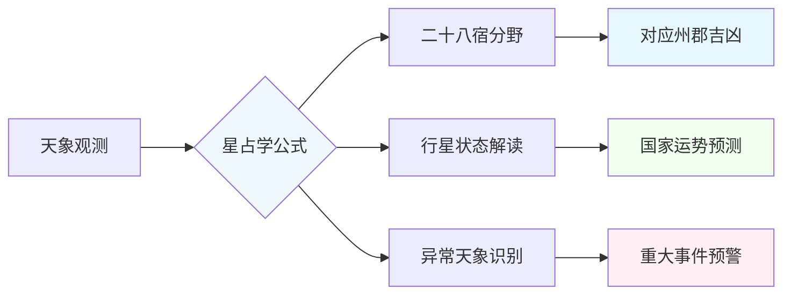

+++
date = '2025-12-29T11:30:00+08:00'
draft = false
title = '中国古代星占学：连接宇宙与宫廷的"加密通讯"'
author = 'Earth'
tags = ['冷知识', '历史', '天文', '文化', '科学史', '中国古代']
categories = ['历史探秘', '科学溯源']
summary = '揭秘中国古代星占学——一门将天象异变与国运兴衰紧密相连的皇家科学，探索其严密的"天象解读公式"与精妙的政治密码功能'
cover = '[封面图片位置]'
math = false
mermaid = true
comments = true
toc = true
+++

#冷知识

[封面图片位置]

> **"夜观天象，预知国运——这不是神话，而是中国古代最高级别的国家机密。"**

想象这样一个场景：你夜观星象，发现某颗星星突然异常明亮。在古代中国，这并非简单的天文现象，而可能预示着千里之外的一场叛乱、一次皇权更迭，或一场即将降临的自然灾害。这不是占星术的臆想，而是在缺乏现代通讯手段的时代，中国官方用以预测国家重大事件的一门严密科学——**中国古代星占学**。

这门学问最奇特之处在于，它自诞生起便是 **"皇家特供"** 的阳春白雪。普通人"夜观天象"在古代是重罪，天象的秘密与解读权被牢牢掌控在皇家天文机构（如司天监、钦天监）手中。唐代李淳风、元代郭守敬等顶尖学者的核心使命之一，便是将天上的异象与地上的国运直接关联，为皇帝决策提供"天意"参考。

## ✨ 反直觉的严密"科学公式"

星占学绝非随心所欲的联想，它拥有一套极为复杂的规则体系，堪称 **"天象解读的精密公式"**。

### 二十八宿与分野理论
- **星区对应**：天空被划分为二十八宿，每宿对应地上的特定州郡（分野）
- **行星解读**：行星的颜色、亮度、运行轨迹（顺行、逆行、留守）都承载着不同的吉凶含义
- **凶兆示例**："荧惑守心"（火星停留在心宿二附近）被视为最高级别的凶兆，直接对应帝王有灾

历史记载中，"荧惑守心"出现时常伴随着皇帝驾崩或权臣被诛。这种预测的"准确性"及其引发的政治动荡，赋予了这门学问致命的力量感。

## 🔐 连接宇宙与宫廷的"加密通讯"

在皇权斗争中，天象演变为一种心照不宣的 **"政治密码"**。

### 天象的政治运作机制
1. **天示警**：当天象预示不吉时，皇帝可能需要颁布"罪己诏"
2. **人事调整**：重大天象常引发朝廷人事变动
3. **政治操作**：官员借解读天象之机打击政敌或为自身造势

这门学问因此不再纯粹，成为连接宇宙法则与人间权谋的精妙桥梁。每一次"天示警"都可能是一场宫廷剧变的序幕，星占学由此融入了中国古代政治的核心运作逻辑。

## 📜 被正史"认证"的超自然存在

星占学的重要性，在官方权威中得到了终极体现：

### 二十四史的庄严记录
- **专门卷章**：几乎每部正史都设有《天文志》或《天官书》
- **严肃史笔**：像记录战争和皇帝起居一样，巨细靡遗地记录重要天象
- **国家认证**：等于承认"上天会干预人间事务"这一核心前提

当我们今天阅读这些记载时，不仅是在查阅天文记录，更是在破解一套古人理解世界、构建政治合法性的核心 **"源代码"**。

## 🌌 为何小众却值得深入了解？

今天，星占学已让位于现代天文学，其核心理论也被科学证伪。但它绝非无用的迷信，而是：

### 1. 文明的"认知活化石"
- 展现古代顶尖头脑如何以惊人的系统性构建理论模型
- 完美体现"天人感应"的传统世界观
- 反映前科学时代人类理解宇宙的宏大尝试

### 2. 理解历史的"密钥"
- 解读重大历史决策背后的"天意"压力
- 为冰冷的历史叙事注入当时的心理动因
- 理解古人行动的逻辑框架与信仰基础

### 3. 科学源头的见证
- 现代天文学脱胎于古老的星象记录
- 今天的嫦娥探月、天眼观星，其起点或许就源于宫廷星官战战兢兢的记录
- 展现人类探索宇宙的永恒欲望

## 🗝️ 开启不同的古代世界图景

了解这门古代"天学"，就像获得了一把特殊的钥匙。它能为你打开一扇门，让你看到一个：

- **天与人紧密纠缠** 的宇宙观
- **宇宙规律与帝国命运同频共振** 的世界图景
- **超自然与政治深度交织** 的历史维度

