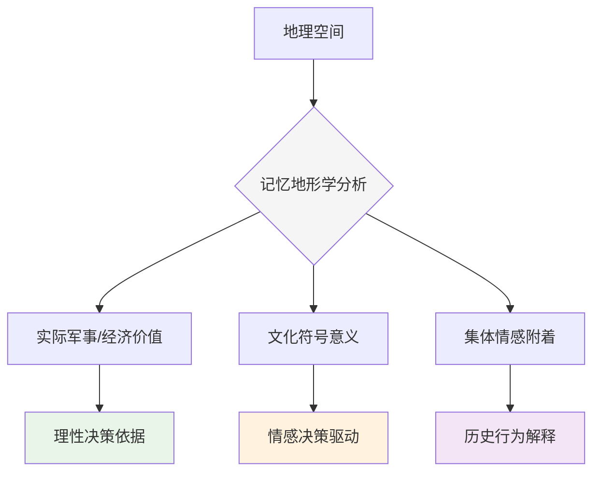

+++
date = '2025-12-29T12:25:00+08:00'
draft = false
title = '记忆地形学：山河讲述的历史与民族心灵的"意念地图"'
author = 'Earth'
tags = ['冷知识', '历史', '地理', '文化', '心理学', '记忆研究']
categories = ['人文探索', '跨学科研究']
summary = '探索历史地理学中的记忆地形学——研究民族集体记忆如何附着于地理空间，塑造"意念地图"并影响历史进程的奇妙领域'
cover = '[封面图片位置]'
math = false
mermaid = true
comments = true
toc = true
+++

#冷知识

[封面图片位置]

> **"山河不语，却承载着整个民族的记忆与情感——这是一张刻在心灵深处的'意念地图'。"**

让我们从微观世界跳出，进入一个游走于历史、地理与集体记忆之间的奇妙领域——**历史地理学中的"记忆地形学"**。

你可能听过"南京的龙脉被斩断"或"山海关是天下第一关"这类说法。这种将历史事件、集体情感甚至神秘力量附着于特定地理空间的现象，正是"记忆地形学"的研究范畴。它不研究地图上的真实坐标，而是探究刻在民族或群体心灵中的那张 **"意念地图"**。这个领域小众到即使在人文学科内部也鲜少被专门提及，却能解释许多教科书无法阐明的历史行为和文化执念。

## 🗺️ "不科学"的地形，如何决定"最现实"的行动？

记忆地形学最反直觉的一点在于：人们经常为一个在军事或经济上价值存疑的地点，付出超乎想象的巨大代价。

### 山海关：符号意义超越军事价值
- **实际作用**：明末时期，山海关的军事防御作用已大不如前
- **符号意义**：作为"隔绝华夷的天下第一雄关"的文化符号意义却无比强大
- **历史影响**：崇祯皇帝与李自成都认为必须不惜代价控制此地，深刻影响了历史走向

这揭示了一个深刻道理：在历史的关键时刻，人心中的 **"地图"** 往往比真实的地形图更有力量。

## 🩹 地图上的伤口：作为"精神创伤"的地理节点

记忆地形学研究某些地点如何成为民族集体记忆中的 **"伤口"** 或 **"圣坛"**。

### 崖山：精神地标的确立
- **地理争议**：广东崖山的具体位置学界仍有争议
- **精神意义**：作为"华夏文明正统首次整体性覆灭"的精神地标意义早已确立
- **历史回响**：数百年来文人墨客、革命志士反复凭吊、书写

一个地点就这样成为了一个民族精神史的活页，翻开即是悲壮的一章。地理坐标承载了远超出其地理本身的重压，成为集体记忆的凝固点。

## 🔗 连接超长时段的"文化密码"

记忆地形学的可延伸性极强，能将史前传说、历史事件、近代国族构建乃至当代地缘政治串联起来。

### "中国"概念的时空演变
- **先秦时期**："中原"为核心的空间认知
- **汉唐时期**："西域"纳入文明视野
- **明清时期**："边疆"概念的重新定义

每一次地图的 **"膨胀"** 或 **"收缩"**，都不仅仅是领土变化，更是文明观念、天下秩序的重新书写。研究这种"意念版图"的变迁，就是在解读一部以山河为纸、以兴衰为墨的立体文明史。

## 💎 为何值得深入了解？

了解记忆地形学，能为你提供一把解码历史和现实的独特钥匙。

### 1. 解释非理性行为
- 解释领土争端为何异常激烈
- 阐明某些城市象征意义大于经济意义的原因
- 揭示人类作为"意义动物"的本质

### 2. "看见"隐形的力量
- 感知古迹地名背后的深层意义
- 理解"这里被认为发生过什么"的历史建构
- 追踪集体记忆如何像地质层一样堆积塑造景观

### 3. 理解"何为中国"的深层脉络
- 从感性角度切入文明认同问题
- 探索疆域连接背后的精神地点连绵
- 解读由共同记忆和情感点亮的文明图谱

## 🧭 思想探险：聆听山河讲述的故事

记忆地形学邀请我们进行一次独特的思想探险：

### 方法论转变
- **暂时放下**：卫星测绘的精确性
- **用心聆听**：山河自己讲述的故事
- **亲手触摸**：由历史情感塑造的"活地图"

### 认知升级
- 理解地点如何获得超越物理空间的意义
- 认识集体记忆的地理锚定机制
- 掌握解读文化景观的深层语法

## 📚 延伸探索与当代应用

### 研究案例推荐
- **南京**：六朝古都的"龙脉"叙事与近代创伤记忆
- **长城**：从军事防线到民族象征的意义变迁
- **黄河**：母亲河的文化意象与生态现实的张力

### 跨学科连接
- **历史学**：重大事件的地理记忆固化
- **心理学**：集体记忆的空间锚定机制
- **社会学**：地标建筑的社会意义生产
- **城市规划**：历史记忆的当代空间再现

### 现实意义
- 文化遗产保护的新视角
- 城市记忆的可持续管理
- 历史教育的空间维度拓展

---

> **最后沉思**：下次当你站在一处古迹前，或听到一个熟悉的地名时，不妨想象一下——这片土地不仅承载着砖石土木的重量，更承载着无数代人的记忆、情感与意义。那是一张由胜利与失败、荣耀与创伤共同编织的、存在于亿万人心中的、持续生长的 **"活地图"**。

**这，或许是最具深度的"冷知识"——一门让山河开口说话、让历史在空间中回响的奇妙学问。**

---
*本文基于历史地理学与人文学科研究，旨在科普跨学科知识领域。欢迎在评论区分享你的见解与思考！*
