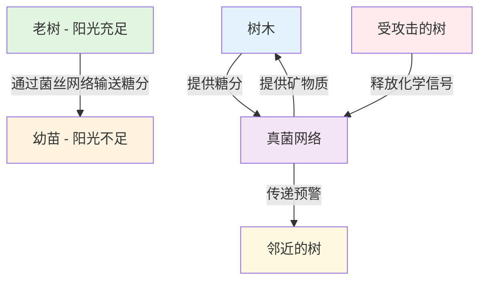

+++
date = '2025-12-28T20:13:33+08:00'
draft = false
title = '蘑菇的语言与森林的"木维网"：地下互联网的智慧'
author = 'Earth'
tags = ['冷知识', '科学', '生态', '真菌', '森林', '智能网络']
categories = ['自然探索', '科学前沿']
summary = '深入探索森林地下的神秘"木维网"——一个由真菌菌丝构成的古老互联网系统，蘑菇仅仅是这个智能网络露出的"Wi-Fi信号灯"'
cover = 'https://images.unsplash.com/photo-1518834103328-93d45986dce1?ixlib=rb-4.0.3&auto=format&fit=crop&w=1200&q=80'
math = false
mermaid = true
comments = true
toc = true
+++

> **"在森林的寂静之下，存在着一个比人类互联网古老亿万倍的对话世界。"**

今天要介绍的小众领域是：**蘑菇的语言与森林的"木维网"**。这不仅仅是"蘑菇会交流"这么简单。我们说的是一个被称为 **"木维网"（Wood Wide Web）** 的地下超级网络，而蘑菇，仅仅是这个庞大、古老、智能的互联网系统露出的"Wi-Fi信号灯"。

## 🌐 什么是"木维网"？

"木维网"是一个由真菌菌丝构成的巨大地下网络，连接着森林中的树木、植物和其他生物。这个网络的功能远比我们想象的复杂：

- **规模**：单个真菌网络可以覆盖数百甚至数千亩的土地
- **年龄**：有些网络已经存在了数千年
- **智能**：能够进行资源分配、信息传递和危险预警

## 🍄 核心发现：蘑菇的真实身份

### 1. 蘑菇不是"植物"，它们是"信号塔"与"贸易官"

**它告诉我们：智能不一定需要大脑。** 解决问题的智慧可以分布式地存在于一个网络之中。

**它重塑了我们对'生命个体'的定义。** 一片森林或许不是一个由独立树木组成的集合，而更像一个超级有机体。那些看似独立的树，可能只是这个巨大生命体伸向空中的'手指'。

**它提供了一种古老的生存哲学：协作而非纯粹竞争，才是复杂系统长期繁荣的基石。** 在人类苦苦思索可持续生存之道时，这个存在于我们脚下数亿年的古老互联网，早已写下了它的答案。

所以，下次你在森林中漫步，踩在松软的落叶上时，请放轻脚步。你正漫步在一个星球的皮肤之上，而它的内部，正运行着一套比人类互联网古老亿万倍、充满智慧与对话的、沉默的'绿色万维网'。这难道不是世界上最酷、最深刻的冷知识吗？
