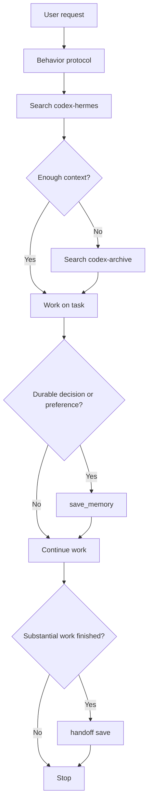

+++
date = '2026-06-02T01:45:00+08:00'
draft = false
title = 'Codex Hermes 记忆系统：它是怎么工作的'
author = 'Earth'
tags = ['Codex', 'MCP', 'SQLite', '知识管理', '开发工具']
categories = ['开发记录']
summary = '这篇文章解释我为 Codex 搭建的 Hermes 风格记忆系统：它的分层结构、工作流、存储原理、自动化边界，以及为什么我选择本地优先而不是把一切交给黑盒。'
math = false
mermaid = true
comments = true
toc = true
+++

> 我最近给 Codex 搭了一套接近 Hermes 风格的长期记忆系统。  
> 它不是“把模型改聪明”，而是给 Codex 增加了一层本地、可检索、可审计、可演进的外部记忆。

很多人一提“AI 记忆”，脑子里浮现的是一种近乎魔法的能力：模型会默默记住你说过的话，自己归纳偏好，越用越懂你。

现实里更稳的路线，反而是把这件事拆开来做。

我现在这套系统，本质上是：

```text
行为协议
+ MCP 记忆服务
+ SQLite 数据库
+ Windows helper 脚本
+ 归档历史导入器
+ 定期记忆回顾自动化
```

它不是一个脚本，也不是一个 prompt，而是一个分层的工具系统。

## 先讲结论：它不是训练，而是外部记忆

这套程序不会修改底层模型权重。

它做的事情更接近：

1. 让 Codex 在开始任务前先回忆相关历史。
2. 在工作中主动保存稳定、有价值的信息。
3. 在任务结束后生成 handoff。
4. 把过去的归档会话整理成可搜索知识。

所以它的核心不是“学习算法”，而是“记忆工程”。

## 第一层：行为协议

我把“什么时候该查、什么时候该记”写进了工作区协议和一个全局 skill。

这一层的职责不是存储数据，而是约束行为：

- 当前项目任务优先搜索 `codex-hermes`
- 旧历史、归档对话、过去尝试再去搜索 `codex-archive`
- 出现长期偏好、项目约定、踩坑修复、handoff 时主动保存
- 不保存 secrets、token、cookie、原始噪音日志

也就是说，真正让系统开始像“会记忆”的，不是数据库，而是这层规则。

## 第二层：MCP 记忆服务

真正的记忆能力由一个本地 MCP 服务提供，也就是 `codex-mem`。

它对外暴露 6 个核心工具：

- `save_memory`
- `search`
- `timeline`
- `get_entries`
- `ingest_docs`
- `retention_dry_run`

这个设计有个很关键的好处：

Codex 不直接碰数据库，而是统一通过工具接口操作记忆。

这让记忆系统变成了一个清晰的服务层，而不是散在脚本和 prompt 里的隐性逻辑。

## 第三层：SQLite 和全文搜索

底层存储我选的是 SQLite。

原因很简单：

- 本地优先
- 可备份
- 可脚本化
- 结构稳定
- 足够快

更重要的是，它用了 FTS5 全文索引。

这意味着检索流程不是“打开一堆 Markdown 慢慢翻”，而是：

```text
query -> FTS index -> compact result list -> fetch details
```

这点很重要，因为长期记忆一旦增长，线性扫描马上就会变得难用。

## 第四层：为什么还需要 helper 脚本

理论上，MCP 工具已经足够了。

但现实是桌面环境和 Windows 会经常给你一点小阻力，比如：

- 某个会话里 MCP 没有热加载
- transport 偶尔关闭
- PowerShell 默认禁止直接运行 `.ps1`

所以我保留了一组 helper：

- `memory-start`
- `memory-save`
- `memory-end`
- `install-memory-git-hook`

再用 `.cmd` 包一层，通过 `ExecutionPolicy Bypass` 调 PowerShell。

这背后的原则很朴素：

主路径要优雅，兜底路径要可靠。

## 第五层：归档历史为什么不能直接塞进数据库

后来我又做了一件事：把 Codex 的历史归档会话全部导入进来。

这一步如果粗暴处理，最简单的做法就是把 `archived_sessions/*.jsonl` 直接入库。

但那会制造一个问题：

原始会话日志太嘈杂了。

里面混着：

- developer instructions
- tool call output
- token 统计
- 中间 commentary
- 最终结果

如果把这些原样吞进去，检索结果会迅速被噪音淹没。

所以我的做法分成两步：

### 第一步：先做摘要

导入器会提取每个归档会话的：

- 会话 ID
- 标题
- 时间
- 工作目录
- 用户请求摘要
- 最终助手结果摘要

然后生成一批 Markdown 摘要文件。

### 第二步：再把摘要入库

这些摘要作为 `archived-session-summary` 导入 `codex-archive` 项目。

这样以后要找旧对话，就检索“知识化后的会话摘要”，而不是回原始 JSONL 里考古。

## 现在的整体工作流

如果把这套系统画成流程图，大概是这样：



它没有什么神秘之处，反而非常工程化。

## 这套程序最重要的几个原则

### 1. 本地优先

我希望长期记忆首先属于我自己，而不是某个远端黑盒。

### 2. 自动辅助，而不是无边界偷记

这套系统现在的模式叫 `automatic-assist`。

意思是：

- 它会默认查
- 会主动记
- 会自动写 handoff

但它还不是“每一轮对话都被动监听并自动提炼”的全自动系统。

我其实觉得这反而是优点，因为这样隐私边界更清楚，噪音也更少。

### 3. 长期记忆只保存 durable facts

真正值得长期保存的是：

- 用户偏好
- 项目约定
- 架构决策
- 非显而易见的修复
- 下次继续工作的 handoff

而不是：

- 原始日志
- 临时猜测
- 一次性报错
- credentials

### 4. 可重跑、可去重

我专门验证了历史导入流程的幂等性。

第一次导入会写入记录；
第二次导入只会命中重复，不会继续长脏数据。

这是长期系统里非常关键但很容易被忽略的一点。

## 现在还不够好的地方

这套程序已经能用，但还不算“完全体”。

我目前最清楚的限制有三个：

### MCP transport 偶尔会断

这会逼着我保留脚本兜底和直接查 SQLite 的路径。

### 删除低价值记忆的工作流还不够顺手

现在已经有 retention dry run，但真正的清理流程还没有做成一个很顺手的对外工具。

### 还不是完整的被动会话捕获

如果未来要更接近 Hermes，我下一步会做的是：

- 统一会话事件提炼
- 更好的去重策略
- 更稳定的自动回顾和压缩

## 为什么我喜欢这种方案

我喜欢它，不是因为它“看起来很 AI”，恰恰相反，是因为它足够朴素。

它承认一件事：

所谓长期记忆，很多时候不是模型突然变聪明，而是你是否愿意把知识的保存、提炼、召回和清理当成一套真正的系统来设计。

这样做出来的东西，虽然少了一点神秘感，但多了很多现实世界里真正有用的品质：

- 可审计
- 可迁移
- 可备份
- 可修复
- 可演进

对我来说，这比“它会自己学会我是谁”更有说服力。
