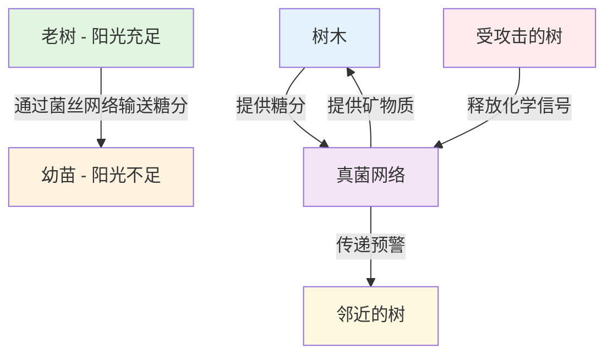

+++
date = '2025-12-28T20:13:33+08:00'
draft = false
title = '蘑菇的语言与森林的"木维网"：地下互联网的智慧'
author = 'Earth'
tags = ['冷知识']
categories = ['冷知识']
summary = '深入探索森林地下的神秘"木维网"——一个由真菌菌丝构成的古老互联网系统，蘑菇仅仅是这个智能网络露出的"Wi-Fi信号灯"'
cover = 'images/funfact/蘑菇的语言与森林的木维网.webp'
math = false
mermaid = true
comments = true
toc = true
+++

#冷知识

[封面图片位置]

> **"在森林的寂静之下，存在着一个比人类互联网古老亿万倍的对话世界。"**

今天，让我们一同潜入森林的地下世界，探索一个鲜为人知却充满智慧的领域：**蘑菇的语言与森林的"木维网"**。这远不止是"蘑菇会交流"这么简单，我们面对的是一个被称为 **"木维网"（Wood Wide Web）** 的地下超级网络。令人惊奇的是，我们日常所见的蘑菇，仅仅是这个庞大、古老、智能的互联网系统露出的"Wi-Fi信号灯"。

## 🌐 什么是"木维网"？

"木维网"是一个由真菌菌丝构成的巨大地下网络，它如同森林的神经系统，将树木、植物和其他生物紧密连接在一起。这个网络的功能之复杂，远超我们的想象：

- **规模宏大**：单个真菌网络可以覆盖数百甚至数千亩的土地，形成庞大的地下连接系统
- **历史悠久**：部分网络已经存在了数千年，见证了森林的世代更替
- **智能运作**：能够进行精准的资源分配、高效的信息传递和及时的预警机制

## 🍄 核心发现：蘑菇的真实身份

### 1. 蘑菇不是"植物"，它们是"信号塔"与"贸易官"

我们日常所见的蘑菇（如松茸、毒蝇伞等），实际上只是一棵巨大真菌为了繁殖而探出地面的"果实"。其真正的生命体，是埋藏在地下、由比头发丝还要纤细的菌丝组成的庞大网状结构。

**关键事实**：
- 蘑菇仅仅是真菌的"生殖器官"，负责传播孢子
- 地下菌丝网络才是真菌真正的生命主体
- 菌丝网络可绵延数千亩，构成森林的"神经系统"

### 2. 森林的"共产主义互联网"

通过木维网，森林实现了令人惊叹的协作机制，堪称自然界的"共产主义互联网"：

| 功能 | 描述 | 类比 |
|------|------|------|
| **资源再分配** | 老树通过网络向幼苗输送糖分，确保森林的可持续发展 | 森林的"社会福利系统" |
| **物质交换** | 树木用糖分交换真菌的矿物质，实现互利共赢 | 地下"全球贸易市场" |
| **信息传递** | 受攻击树木释放化学预警信号，实现快速响应 | 植物界的"即时通讯" |
| **集体防御** | 邻近树木提前启动防御机制，形成集体保护 | 森林的"免疫系统" |

### 3. 真菌的"语言"：电脉冲通信

英国计算机学家 **Andrew Adamatzky** 的突破性研究揭示了真菌可能拥有自己的"语言"系统：

**实验发现**：
- 真菌菌丝会产生规律的电脉冲，形成独特的通信模式
- 这些脉冲构成复杂的峰值序列，具有明显的规律性
- 模式结构与人类语言的词汇长度分布惊人相似

**识别出的"词汇"**：
- 大约50种不同的电脉冲模式，构成基本"词汇库"
- 可能用于传递食物位置、危险信号、环境变化等信息
- 暗示着地下世界存在着持续不断的"缓慢对话"

## 🔬 科学意义与哲学启示

### 为什么这个领域至关重要？

1. **颠覆传统生命观**
   - 挑战"个体竞争"的达尔文主义，强调协作共生的进化优势
   - 重新定义"智能"和"意识"的概念边界
   - 展示分布式智能系统的强大生命力

2. **重新认识森林**
   - 森林不是树木的简单集合，而是**超级有机体**
   - 树木是超级有机体的"器官"，各司其职
   - 真菌网络是连接一切的"神经系统"，实现整体协调

3. **生态学启示**
   - 为可持续农业提供全新的生态学思路
   - 启示气候变化应对策略的复杂性思维
   - 展示复杂系统在逆境中的生存智慧

## 💭 对人类社会的启示

木维网的发现为我们提供了深刻的哲学思考：

> "在人类苦苦构建互联网、人工智能时，大自然早已运行着一个更古老、更智慧的版本。"

### 关键启示：
1. **分布式智能**：复杂问题的解决不需要中央大脑，分布式系统更具韧性
2. **协作优先**：长期繁荣基于互助共生而非纯粹竞争，集体智慧超越个体力量  
3. **缓慢智慧**：快速反应不是智能的唯一形式，缓慢而深刻的思考同样重要
4. **隐形连接**：最重要的联系往往不可见，真正的力量隐藏在看不见的网络中

## 🌳 实践建议：如何"聆听"森林？

1. **观察蘑菇**：注意不同蘑菇的出现模式、位置和季节变化，它们是地下网络的"信号灯"
2. **尊重土壤**：减少对森林地面的干扰，保护脆弱的菌丝网络
3. **学习耐心**：理解自然系统的"缓慢时间尺度"，培养与自然同步的节奏感
4. **跨学科思考**：结合生态学、计算机科学和哲学视角，获得更全面的认知

## 📚 延伸阅读与资源

### 推荐书籍：
- 《树木的隐秘生活》 by Peter Wohlleben
- 《真菌的秘密生命》 by Merlin Sheldrake
- 《森林如何思考》 by Eduardo Kohn

### 研究机构：
- 英国真菌学会
- 国际森林研究组织
- 复杂系统研究中心

---

> **最后思考**：下次当你在森林中漫步，踩在松软的落叶上时，请放轻脚步。你正漫步在一个星球的皮肤之上，而它的内部，正运行着一套比人类互联网古老亿万倍、充满智慧与对话的、沉默的"绿色万维网"。

**这难道不是世界上最酷、最深刻的冷知识吗？**

---
*本文基于最新真菌生态学研究，将持续更新相关发现。欢迎在评论区分享你的想法和问题！*
